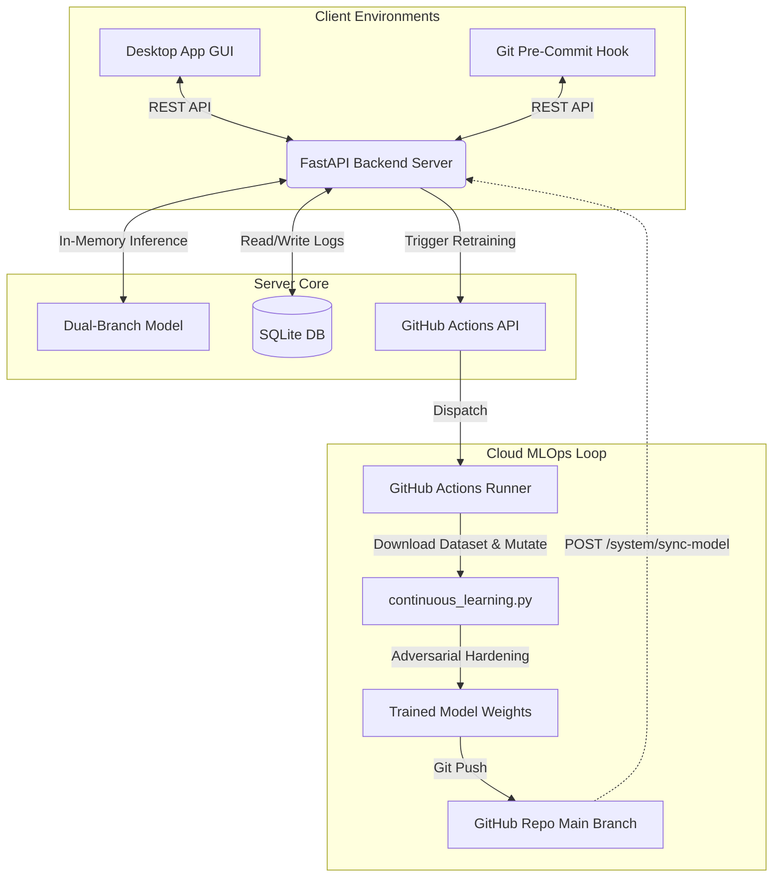

# Adaptive Threat Detection

An advanced, API-driven malware detection and prevention system featuring a **Dual-Branch Deep Learning Model** that integrates Convolutional Neural Networks (CNN) and Bidirectional Long Short-Term Memory (BiLSTM) architectures to analyze both spatial (structural binary visualization) and temporal (API/opcode sequence) features of binary files.

The system is designed with a modern **Thin-Client & Server Architecture**, featuring a FastAPI backend, a CustomTkinter desktop client, a Git Pre-commit hook command-line tool, and an automated MLOps continuous learning loop powered by GitHub Actions.

---

## 📁 Repository Directory Structure

The repository has been structured to separate core production components from academic references and development utilities:

*   **`prototype/backend/`** — Core FastAPI server handling AI model inference, database telemetry, and remote MLOps dispatch.
    *   [main.py](file:///d:/Adaptive-Threat-Detection/prototype/backend/main.py) — Server application entrypoint and REST endpoints.
    *   [scanner.py](file:///d:/Adaptive-Threat-Detection/prototype/backend/scanner.py) — In-memory AI scanner manager.
    *   [config.py](file:///d:/Adaptive-Threat-Detection/prototype/backend/config.py) — Application configuration and environment credentials.
    *   [database.py](file:///d:/Adaptive-Threat-Detection/prototype/backend/database.py) / [models.py](file:///d:/Adaptive-Threat-Detection/prototype/backend/models.py) — SQLAlchemy SQLite database structure for threat logging and system metrics.
*   **`models/`** — Core PyTorch model definitions.
    *   [cnn_branch.py](file:///d:/Adaptive-Threat-Detection/models/cnn_branch.py) — 2D Convolutional neural network branch for spatial byte-visualizations.
    *   [lstm_branch.py](file:///d:/Adaptive-Threat-Detection/models/lstm_branch.py) — Bidirectional LSTM branch with attention for temporal import sequences.
    *   [dual_branch_model.py](file:///d:/Adaptive-Threat-Detection/models/dual_branch_model.py) — Multi-modal fusion framework supporting concatenation, addition, or attention.
*   **`thesis_materials/`** — LaTeX source, speech transcripts, reports, slides, and posters for academic presentations.
*   **`development_scripts/`** — Dataset preparation, feature extraction, and model debugging utilities.
*   **`training_and_evaluation/`** — Deep learning training loops, evaluation runners, and visualization tools.
*   **`model_archive/`** — Historic checkpoints, evaluation heatmaps, and legacy pipeline mockups.
*   **`data/`** — Dataset directories containing compressed binary datasets and metadata.
*   **`quarantine/`** — Isolated directory where flagged malicious files are automatically moved by the Git Threat Protector.

---

## ⚙️ System Architecture & Workflow



### 1. Dual-Branch AI Engine
The neural network analyzes binary executable files through two modalities:
1.  **Spatial CNN Branch**: Transforms raw binary bytes into a normalized 2D structural image, capturing spatial structural features characteristic of packed, encrypted, or obfuscated malware sections.
2.  **Temporal LSTM Branch**: Parses the Portable Executable (PE) import table to extract functional API call sequences, feeding them into a Bidirectional LSTM with an Attention mechanism to classify sequential execution intent.
3.  **Attention-Weighted Fusion**: Merges feature spaces and performs final classification into *Benign* or *Malware*.

### 2. FastAPI Backend
The API server ([main.py](file:///d:/Adaptive-Threat-Detection/prototype/backend/main.py)) acts as the single point of intelligence. It is run locally or in the cloud. It loads the active checkpoint ([adaptive_model_final.pth](file:///d:/Adaptive-Threat-Detection/adaptive_model_final.pth)) in-memory to provide rapid classification results, avoiding PyTorch load overhead on clients. It records security telemetry in an SQLite database ([threat_detection.db](file:///d:/Adaptive-Threat-Detection/threat_detection.db)).

### 3. Git Threat Protector (Guardian)
An automated pre-commit hook script ([git_threat_protector.py](file:///d:/Adaptive-Threat-Detection/git_threat_protector.py)) that prevents engineers from committing malware to the repository. Staged files are intercepted, filtered (ignoring non-executable binaries like `.pdf`, `.zip`, and database assets to speed up operations), and scanned. If malware is detected, the commit is blocked and the following automated outcomes are triggered:
*   **Quarantine**: Moves the malicious file into a root-level `quarantine/` directory.
*   **Roll Back Manifest**: Resets the staged file out of the Git index (`git reset`).
*   **Self-Heal**: Option to delete the file from the workspace.
*   **Lockout**: Creates a lock file (`.git_lockout`) blocking subsequent Git scans/commits until resolved in the GUI.

### 4. CustomTkinter Desktop Client
A premium GUI ([desktop_app.py](file:///d:/Adaptive-Threat-Detection/desktop_app.py)) that communicates with the FastAPI backend. It allows users to:
*   Scan local files on-demand.
*   View threat statistics, accuracy metrics, and recent scan history.
*   Install or uninstall the Git Threat Protector hook.
*   Trigger cloud retraining workflows and synchronize the model dynamically.

---

## 🚀 Quick Start & Deployment

### 1. Install Dependencies
Install the required packages on your development machine:
```bash
pip install -r requirements.txt
pip install -r prototype/backend/requirements.txt
```

### 2. Start the FastAPI Server
Create a launch script `run_server.bat` (automatically ignored by Git to protect secrets) containing your credentials:
```batch
@echo off
set GITHUB_TOKEN=your_github_personal_access_token
set GITHUB_REPO=your_username/your_repository_name
python -m uvicorn prototype.backend.main:app --host 0.0.0.0 --port 8000
```
Then execute it to start the server at `http://127.0.0.1:8000`.

### 3. Run the Desktop GUI
Launch the tkinter application:
```bash
python desktop_app.py
```
*Default admin credentials: Username `admin`, Password `securepassword`.*

### 4. Install the Git Threat Shield
To install the pre-commit hook in your local Git repository, run:
```bash
python git_threat_protector.py install
```
To verify its current status:
```bash
python git_threat_protector.py status
```
To simulate a commit block (without actually committing):
```bash
python git_threat_protector.py test
```

---

## 🔄 MLOps Cloud Retraining & Sync Loop

The project implements a full cloud retraining loop to harden the model against evasion attempts and adversarial mutations:

1.  **Adversarial Hardening Script**: [continuous_learning.py](file:///d:/Adaptive-Threat-Detection/continuous_learning.py) loads base datasets, generates mutated variants using the [ThreatMutator](file:///d:/Adaptive-Threat-Detection/utils/mutator.py) (e.g., random padding, noise insertion, import sequence shifting), and fine-tunes the model on these variants.
2.  **GitHub Actions Runner**: The workflow [.github/workflows/retrain.yml](file:///d:/Adaptive-Threat-Detection/.github/workflows/retrain.yml) is dispatched via REST call when you trigger evolution. It executes the hardening script on a CPU-only runner to prevent out-of-memory errors and automatically commits updated weights back to the repository.
3.  **Live Weights Synchronization**: Once retraining completes, calling the `/system/sync-model` API endpoint downloads the updated model from GitHub, updates the local weights, and reloads the scanner in-memory with zero server downtime.
